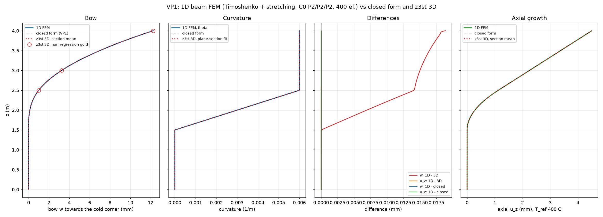
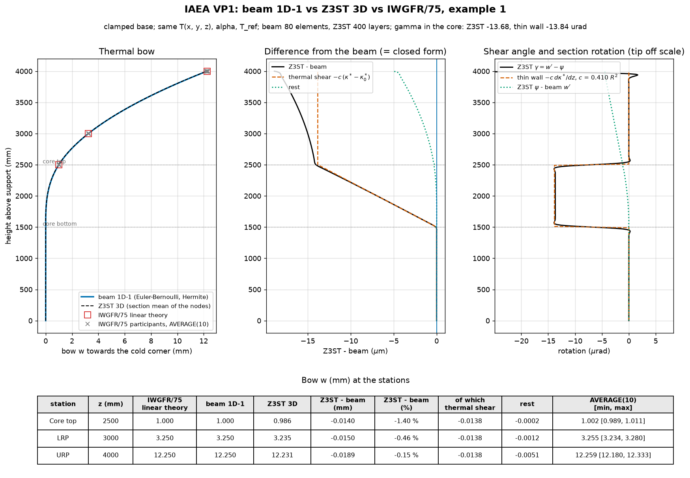
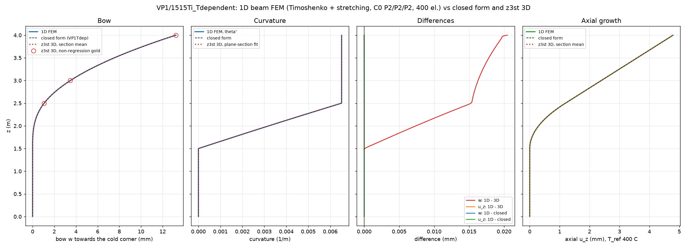
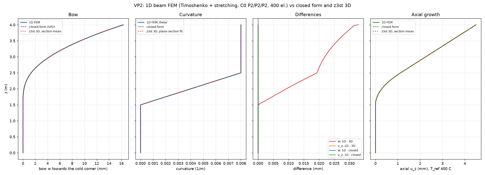

# beam_timoshenko_fx.py: the 1D FEM of the IAEA ducts in dolfinx

How `beam_timoshenko_fx.py` (next to this file) reduces the 3D duct to a 1D beam and solves
it with dolfinx 0.11, what it gives on VP1 / VP1 T-dependent / VP2, and how it
relates to `U_hex_beam/beam1d` and `U_hex_beam/VP1/beam_fx.py`.

The three 1D codes in these notes:

| Name | Path | Author | Method |
|---|---|---|---|
| `beam1d` | `U_hex_beam/beam1d/` | Bianca | numpy, EB, cubic Hermite |
| `beam_fx.py` | `U_hex_beam/VP1/beam_fx.py` | Bianca | dolfinx, EB, mixed (u, M) |
| `beam_timoshenko_fx.py` | `U_hex_shell/bowing/corner-corner/IAEA/` | ours | dolfinx, Timoshenko (u, w, theta), E(T) via S |

## 0. Overview in five steps

The idea: turn the 3D hexagonal duct into a single line along z, with a few
properties per height, and solve a beam problem on that line with dolfinx.
Sections 1–4 give the details.

### Step 1. Collapse each cross-section to a few numbers

At each height z, the hexagonal wall is replaced by its mid-wall line. That
line is sampled at 2400 points (400 per flat), and each point stands for a
small piece of wall with area dA = t·dp.

At each point I evaluate the same temperature function the 3D run uses
(`T_vp1` or `T_vp2`). From it I get E (constant, or E(T) from the card) and the
thermal strain ε_th = α(T − T_ref), or the card's own law for 15-15Ti.

With c measured from the section centre towards the cold corner, I sum over
the section:

| Quantity | Formula | Meaning |
|---|---|---|
| EA | ∫E dA | axial stiffness |
| EI | ∫E c² dA | bending stiffness |
| S | ∫E c dA | stretching–bending coupling (0 when E is uniform) |
| GA | 0.5 · EA / (2(1+ν)) | shear stiffness |
| N* | ∫E ε_th dA | thermal axial force |
| M* | −∫E ε_th c dA | thermal bending moment |

This is repeated at 4001 heights. The 3D thermal problem is now six curves
along z.

### Step 2. Pick the beam model and write its energy

There are three unknowns along z:
- **u(z):** axial displacement
- **w(z):** lateral deflection towards the cold corner
- **θ(z):** rotation of the section

A fibre at position c has strain ε = u′ − c·θ′. The elastic energy, with shear
added, is

```
Π = ½∫∫ E (ε − ε_th)² dA dz + ½∫ GA (w′ − θ)² dz
```

Expanding the square and using the sums of step 1 gives the weak form:

```
a = ∫ [ EA u′du′ − S(θ′du′ + u′dθ′) + EI θ′dθ′ + GA(w′−θ)(dw′−dθ) ] dz
L = ∫ [ N* du′ + M* dθ′ ] dz
```

**Why this form.** Only first derivatives appear, so ordinary continuous
Lagrange elements (P2) work. Euler–Bernoulli needs w″, which needs C¹
elements, and dolfinx's Hermite elements are broken on non-uniform meshes
(section 4). That is why they are avoided.

**Why the answer is still Euler–Bernoulli.** In free bowing there is no
lateral load, so the shear force GA(w′ − θ) is exactly zero. That forces
w′ = θ, which is the Euler–Bernoulli result. The value of GA does not matter
here. It will matter once pads or contact forces are added.

**What S does.** When E depends on T, the stiffness-weighted centre shifts
towards the cold side. S then couples stretching and bending. Without it, u_z
was 5 µm off in the T-dependent case.

### Step 3. Put it into dolfinx

```python
dom = mesh.create_interval(MPI.COMM_SELF, 400, [0.0, H])          # 1D line, 400 elements

# the six section curves -> P1 functions on the mesh
EA, S, EI, GA, Ns, Ms = (coef(k) for k in ("EA", "S", "EI", "GA", "N", "M"))

P2 = basix.ufl.element("Lagrange", "interval", 2)
W  = fem.functionspace(dom, basix.ufl.mixed_element([P2, P2, P2]))  # (u, w, θ)
u, w, th    = ufl.TrialFunctions(W)
du, dw, dth = ufl.TestFunctions(W)

a = (EA*u.dx(0)*du.dx(0) - S*(th.dx(0)*du.dx(0) + u.dx(0)*dth.dx(0))
     + EI*th.dx(0)*dth.dx(0) + GA*(w.dx(0)-th)*(dw.dx(0)-dth)) * ufl.dx
L = (Ns*du.dx(0) + Ms*dth.dx(0)) * ufl.dx
```

`coef` interpolates each curve of step 1 onto a P1 function.

### Step 4. Boundary conditions and solve

- **Bottom (z = 0), clamped:** u = w = θ = 0. Each of the three subspaces gets
  a Dirichlet condition through `locate_dofs_topological(W.sub(i), 0, facets)`.
- **Top:** free, so nothing needs to be imposed.
- **Solve:** a direct LU solve with
  `LinearProblem(..., petsc_options_prefix="beam_")`.
- **Extract the results:** `sol.sub(i).collapse()` gives u, w and θ at the
  nodes, sorted by z.

### Step 5. Mesh detail that matters

The temperature has kinks at z = 1.5 m and 2.5 m, where the core starts and
ends. The coefficients are piecewise linear, so those heights must be nodes.
With 400 elements of 1 cm each, they are.

A coarser mesh shows why: 8 elements has nodes at the kinks and is already
exact for VP1. 12 elements misses them and is worse than 8.

### Result

The tip deflection matches the closed form to about 1e-7 mm for VP1. That is
12.2500 mm, and Bianca's two codes give the same value. The difference from
z3st 3D is 0.019 mm (0.15 %). Bianca's `vp1_vs_z3st.py` shows that most of it
(0.0138 mm) is thermal shear, which the 3D model has and no 1D beam model
includes (section 5).

## 1. Reduction 3D -> 1D

Section sums on the mid-wall line (thin wall, dA = t dp), at every z. `c` is the
coordinate from the geometric centre of the section towards the cold corner
(`-(cos PHI_HOT, sin PHI_HOT)`), and `eps_th` is the thermal strain of the card:

```
EA = int E dA              S  = int E c dA            N* =   int E eps_th dA
EI = int E c^2 dA          M* = - int E eps_th c dA
GA = K_SHEAR * EA / (2 (1 + nu)),   K_SHEAR = 0.5 (thin closed tube)
```

- Quadrature: N_P = 2400 midpoints on the mid-wall hexagon (400 per flat, from
  `hex_post.perimeter_point`), N_ZK = 4001 levels in z.
- T comes from the case's temperature module (`T_vp1`, `T_vp2`), the same
  function the 3D run uses as its eigenstrain, evaluated on numpy arrays.
- Constant card: `E` constant, `eps_th = alpha (T - T_ref)`. T-dependent card:
  the card's `E` hook (`E_Sobolev`) and `thermal_strain` hook, `expansion_law`.
- Reference axis: the geometric centre, as the section-mean displacement of
  z3st and the closed forms. With E(T) the E-weighted centroid moves off this
  axis, so S != 0 and stretching and bending couple. With a constant card,
  S = 0 and the problems decouple, as in beam1d (`B1 = 0`, Ma Eq. 17).

N* and M* are force and moment resultants. For a constant card they relate to
the per-area / per-inertia loads of beam1d by N* = EA eps0* and
M* = EI kappa* (up to the sign convention of kappa*).

## 2. Weak form

Fibre strain `eps = u' - c theta'` (u axial, theta section rotation, w lateral
deflection towards the cold corner). The energy

```
Pi = 1/2 int int E (eps - eps_th)^2 dA dz + 1/2 int GA (w' - theta)^2 dz
```

expanded with the sums of section 1 gives the bilinear and linear forms:

```
a = int [ EA u' du' - S (theta' du' + u' dtheta') + EI theta' dtheta'
          + GA (w' - theta)(dw' - dtheta) ] dz
L = int [ N* du' + M* dtheta' ] dz
```

Timoshenko beam with stretching, unknowns (u, w, theta), all Lagrange P2: only
first derivatives appear, so C0 elements are enough.

**Why Timoshenko gives the Euler–Bernoulli answer here.** Without lateral loads
the shear force V = GA (w' - theta) is zero, so w' = theta exactly and the
solution is the EB one: the closed form. GA only has to be positive. It starts
to matter with pads, springs or lateral loads. Then check for shear locking
(GA H^2 / EI ~ 1e3 for VP1, mild with P2 and n = 400).

**Boundary conditions.** Clamp at z = 0: u = w = theta = 0, Dirichlet on the
three subspaces. Free top: natural.

## 3. dolfinx code (core of `solve`)

```python
dom = mesh.create_interval(MPI.COMM_SELF, n_el, [0.0, H])
Q1 = fem.functionspace(dom, ("Lagrange", 1))
def coef(key):                       # section sums -> P1 coefficient functions
    f = fem.Function(Q1)
    f.x.array[:] = np.interp(Q1.tabulate_dof_coordinates()[:, 0], sec["z"], sec[key])
    return f
EA, S, EI, GA, Ns, Ms = (coef(k) for k in ("EA", "S", "EI", "GA", "N", "M"))

P2 = basix.ufl.element("Lagrange", "interval", 2)
W = fem.functionspace(dom, basix.ufl.mixed_element([P2, P2, P2]))
u, w, th = ufl.TrialFunctions(W)
du, dw, dth = ufl.TestFunctions(W)
a = (EA * u.dx(0) * du.dx(0) - S * (th.dx(0) * du.dx(0) + u.dx(0) * dth.dx(0))
     + EI * th.dx(0) * dth.dx(0) + GA * (w.dx(0) - th) * (dw.dx(0) - dth)) * ufl.dx
L = (Ns * du.dx(0) + Ms * dth.dx(0)) * ufl.dx

clamp = mesh.locate_entities_boundary(dom, 0, lambda x: np.isclose(x[0], 0.0))
bcs = [fem.dirichletbc(PETSc.ScalarType(0.0),
                       fem.locate_dofs_topological(W.sub(i), 0, clamp), W.sub(i))
       for i in (0, 1, 2)]
sol = LinearProblem(a, L, bcs=bcs, petsc_options_prefix="beam_",
                    petsc_options={"ksp_type": "preonly", "pc_type": "lu"}).solve()
```

**Mesh.** `n_el` uniform elements, default 400. A multiple of 8 puts nodes at
z = 1.5 and 2.5 m, where the core ramp has kinks. The coefficients are P1, so
the kinks must be nodes: n = 12 (no node at the kinks) is worse than n = 8.

**Output.** `sol.sub(i).collapse()`, values sorted by the dof coordinates. No
point evaluation is needed.

## 4. dolfinx 0.10/0.11 pitfalls hit on the way

| Old / wrong | Works in 0.11 |
|---|---|
| `ufl.FiniteElement`, `ufl.MixedElement` | `basix.ufl.element`, `basix.ufl.mixed_element` |
| `fem.FunctionSpace(mesh, el)` | `fem.functionspace(mesh, el)` |
| `LinearProblem(a, L, bcs, petsc_options=...)` | also `petsc_options_prefix="..."` (required) |
| `dirichletbc(scalar, locate_dofs_geometrical((W.sub(i), V), ...), W.sub(i))` | `locate_dofs_topological(W.sub(i), 0, facets)` with a scalar value |
| `f.eval(p, cell 0)` at the tip | the cell from `geometry.bb_tree` + `compute_colliding_cells` (cell 0 returns garbage, not an error) |
| `basix.ufl.element("Hermite", ...)` | `basix.ufl.element(basix.ElementFamily.Hermite, basix.CellType.interval, 3)` |

**Hermite in dolfinx (`--element hermite`).** This is the EB C1 variant:
(u P2, w cubic Hermite), with `theta = w'`, `w''` in the form, and a clamp on
the value and slope dofs of w. It is exact on a uniform mesh (VP1 at n = 8).
On a graded mesh it is wrong by 20–33 %.

The cause: the Hermite slope dof is stored in reference coordinates and
dolfinx does not scale it by the cell size h. A slope dof = 1 gives slope 4.0
in a cell of h = 0.25 and 1.333 in one of h = 0.75. The shared dof then means
a different physical slope on each side, so C1 continuity is lost.
`interpolate` also leaves the slope dofs at 0. `beam_timoshenko_fx.py` therefore raises
an error on a non-uniform mesh.

beam1d does not have this problem, because it assembles the Hermite element
by hand with the physical L in N_phi.

## 4b. Why C⁰ by default, and when C¹ works

C¹ is available: `beam_timoshenko_fx.py --element hermite` is Euler–Bernoulli
with the Basix cubic Hermite element. The restriction is that dolfinx's
Hermite element is only correct on a **uniform mesh**. On a mesh with
different element lengths it quietly loses C¹ and gives wrong answers. That is
why the default is the C⁰ mixed form, which works on any mesh.

### Why it breaks

A cubic Hermite element has two unknowns per node: the deflection v and the
slope. dolfinx stores that slope in the coordinates of the reference element,
where every element has length 1. It does not store dv/dz. The real slope is
the stored value divided by the element length h:

```
dv/dz = (1/h) · (stored slope)
```

Two neighbouring elements share the same stored value at their common node:
- **Same h on both sides:** both elements see the same real slope, so the
  curve is C¹.
- **Different h:** the same stored value means different real slopes on each
  side, so there is a kink exactly where Hermite is supposed to prevent one.

**Test.** A stored slope of 1 gave dv/dz = 4.0 in an element with h = 0.25
and 1.333 in the neighbouring element with h = 0.75. On a graded mesh, the
bowing result was 20–33 % wrong.

A correct implementation would rescale the slope by each element's length
during assembly. dolfinx does not do that for Hermite. Its DOF
transformations only handle the orientation of the reference cell, not
scaling.

Two related facts:
- **beam1d does not have this problem.** It builds the Hermite element by hand
  in numpy and puts the real h into the slope shape functions
  (N_1phi = L (xi − 2 xi² + xi³), ...).
- **`interpolate` sets every slope value to 0.** So a Hermite function cannot
  be loaded from a formula either.

### What this means for the IAEA cases

For VP1 and VP2 it does not matter. A uniform mesh with nodes at the kinks
(1.5 m and 2.5 m: any element count that is a multiple of 8) is all that is
needed, and the Hermite option there matches the closed form. It is even exact
with 8 elements for VP1. `beam_timoshenko_fx.py` raises an error if the
Hermite option is used on a non-uniform mesh.

If C¹ is needed on a graded mesh (for example JOYO with closely spaced pads),
there are three options:
1. **Compute on a uniform grid and stretch it.** Use a uniform mesh in a
   coordinate s, define the physical height as z = z(s), and put the
   chain-rule factors (dz/ds and its derivative) into the weak form. The
   Hermite element stays correct because the mesh it sees is uniform.
2. **C⁰ interior penalty.** Keep only v, use ordinary P2 elements, and add
   penalty terms on the slope jumps between elements. This is the standard
   FEniCS method for fourth-order problems (their biharmonic demo).
3. **Assemble Hermite by hand, as in beam1d.** This gives full control.

### Why the mixed form is the default anyway

For free bowing, the C⁰ Timoshenko form gives exactly the Euler–Bernoulli
answer, because the shear force is zero (section 2). It also works on any
mesh and handles E(T) and the S coupling without changes. C¹ does not make
the result more accurate here. It is another valid route, and dolfinx only
supports it correctly on uniform meshes.

## 5. Results

Runs of 16 Nov 2026, branch `fuelassembly` at `8fd37ec`, dolfinx 0.11.0.

- **beam_timoshenko_fx.py:** `--element mixed --n 400`.
- **z3st 3D:** the section mean of the nodes in `output/*_fields_3d.xdmf` (`hex_post.analyse`).
- **gold:** `non-regression_gold.json` of the 3D case.
- **beam1d / beam_fx:** Bianca's `U_hex_beam/VP1/Allrun` plus `beam_fx.py`, nz = 80, run on a copy.

Figures and the `_summary.json` files are in `beam_timoshenko_fx_NOTES_figures/`.

### 5.1 VP1, constant card: all solvers

Lateral bow w towards the cold corner (mm):

| z (m) | closed form | beam1d (Bianca; EB Hermite, numpy) | beam_fx (Bianca; mixed u–M, dolfinx P3) | beam_timoshenko_fx.py (ours; Timoshenko, dolfinx P2) | z3st 3D | 3D gold | IWGFR/75 AVERAGE(10) [min, max] |
|---|---|---|---|---|---|---|---|
| 2.5 core top | 1.000000 | 1.000000 | 1.000000 | 1.000000 | 0.985954 | 0.985954 | 1.002 [0.989, 1.011] |
| 3.0 LRP | 3.250000 | 3.250000 | 3.250000 | 3.250000 | 3.234996 | 3.234996 | 3.255 [3.234, 3.280] |
| 4.0 URP | 12.250000 | 12.250000 | 12.250000 | 12.250000 | 12.231107 | 12.231108 | 12.259 [12.180, 12.333] |

Axial growth u_z (mm, T_ref = 400 °C). This is identical in all models, 3D
included, to within 3e-6 mm:

| z (m) | 2.5 | 3.0 | 4.0 |
|---|---|---|---|
| u_z | 1.125000 | 2.250000 | 4.500000 |

Errors:

| | beam_timoshenko_fx.py (ours) | beam1d (Bianca; `non-regression.py`, tol 1e-8) |
|---|---|---|
| max \|w − closed\| | 6.6e-8 mm | rel 5.0e-10 at URP |
| max \|u_z − closed\| | 3.9e-11 mm | rel 2.3e-14 at URP |
| max \|w − 3D\| | 0.0189 mm (0.15 % of tip) | 0.0189 mm |
| max \|u_z − 3D\| | 2.1e-5 mm | 0 at the stations |

Every one of the 31 checks in `beam1d` `non-regression.py` passes.
`beam_fx` vs `beam1d`: max |u_y| difference 6.1e-12 m, max |u_y'| difference
2.2e-12, max |u_z| difference 7.0e-7 m (see section 6).



*beam_timoshenko_fx.py, VP1. From left to right:*
1. *Bow.* 1D, the closed form and 3D overlap; the circles are the 3D gold.
2. *Curvature theta'.* 0 below the core, linear across it, constant
   alpha·50 K / 0.150 m = 6.0e-3 1/m above it.
3. *Differences.* 1D − closed is 0 on this scale. 1D − 3D grows linearly
   across the core, up to 0.014 mm, then reaches 0.019 mm at the tip.
4. *Axial growth.*



*Bianca's `vp1_vs_z3st.py` (plots her `beam1d`). The 3D − beam gap, split into thermal shear
−c(kappa* − kappa0*) and the rest:*

| station | Z3ST − beam (mm) | thermal shear (mm) | rest (mm) |
|---|---|---|---|
| core top | −0.0140 | −0.0138 | −0.0002 |
| LRP | −0.0150 | −0.0138 | −0.0012 |
| URP | −0.0189 | −0.0138 | −0.0051 |

The thermal shear builds up across the core: the 3D shear angle is
γ ≈ −13.7 µrad there, against −13.8 µrad from the thin-wall formula,
c = 0.410 R². Above the core it stays as a constant offset. Neither 1D model
has this term. The rest grows towards the tip.

### 5.2 VP1 T-dependent (15-15Ti, Sobolev E(T) and expansion law)

beam_timoshenko_fx.py only, because beam1d rejects a non-uniform E.

| z (m) | w 1D | w closed (VP1Tdep) | w 3D | w gold | u_z 1D | u_z closed | u_z 3D |
|---|---|---|---|---|---|---|---|
| 2.5 | 1.066226 | 1.066231 | 1.050974 | 1.050974 | 1.192433 | 1.192435 | 1.192437 |
| 3.0 | 3.490285 | 3.490296 | 3.474005 | 3.474005 | 2.392398 | 2.392400 | 2.392398 |
| 4.0 | 13.227045 | 13.227066 | 13.206570 | 13.206570 | 4.792328 | 4.792330 | 4.792327 |

- **1D vs closed form:** max |Δw| = 2.1e-5 mm (tip rel 1.6e-6) and max
  |Δu_z| = 1.9e-6 mm. This is larger than for VP1, most likely because P1
  interpolates the coefficients, which are non-linear in z through E(T) (not
  isolated).
- **1D vs 3D:** max |Δw| = 0.0205 mm (0.15 %).
- **S coupling:** S != 0 here. Without the S coupling, u_z was off by about 5 µm.



### 5.3 VP2 (non-linear section T, C = 4/3)

| z (m) | w 1D | w closed (VP2) | w 3D | u_z 1D = closed | u_z 3D |
|---|---|---|---|---|---|
| 2.5 | 1.333333 | 1.333333 | 1.314087 | 1.125000 | 1.125003 |
| 3.0 | 4.333333 | 4.333333 | 4.311448 | 2.250000 | 2.250000 |
| 4.0 | 16.333333 | 16.333333 | 16.300412 | 4.500000 | 4.500000 |

- **1D vs closed form:** max |Δw| = 8.7e-8 mm.
- **1D vs 3D:** max |Δw| = 0.0329 mm (0.20 % of tip).
- **No gold stations:** the VP2 3D case has no gold file, so its stations are
  not checked against one.



### 5.4 Summary

| case | tip w 1D | closed | 3D | 1D − 3D (mm) | 1D − 3D / tip |
|---|---|---|---|---|---|
| VP1 | 12.2500 | 12.2500 | 12.2311 | 0.0189 | 0.15 % |
| VP1 T-dep | 13.2270 | 13.2271 | 13.2066 | 0.0205 | 0.15 % |
| VP2 | 16.3333 | 16.3333 | 16.3004 | 0.0329 | 0.20 % |

The thermal-shear split was only computed for VP1. For the other two cases,
the share of the gap due to thermal shear is not checked.

## 6. beam_timoshenko_fx.py vs beam1d / beam_fx

| | beam1d (Bianca) | beam_fx (Bianca) | beam_timoshenko_fx.py (ours) |
|---|---|---|---|
| solver | numpy, hand assembly | dolfinx | dolfinx |
| bending | EB, cubic Hermite (C1) | EB, mixed (u, M), P2/P3 | Timoshenko (u, w, theta), P2 |
| rotation BC | Dirichlet on phi | natural (theta in RHS), M = 0 essential at a free end | Dirichlet on theta |
| E over the section | uniform only (`NotImplementedError`) | uniform | E(T): S couples axial and bending |
| section integrals | Gauss through the wall | from beam1d | thin wall, mid-wall line |
| pads / contact | active set | not yet | not yet (springs at a point would enter `a`) |
| non-uniform mesh | yes | yes | yes (mixed); Hermite variant uniform only |

**Side note on the beam_fx vs beam1d u_z difference (7.03e-7 m).** This is the
P1 interpolation error of beam1d's linear rod between nodes, sampled at the 801
plotting points: h^2/8 u_z'' = 0.05^2/8 · alpha · 125 K / 1 m = 7.03e-7 m. The
nodal values agree.

## 7. Running

```bash
# from this folder, z3st conda env; the worktree must be first on the path,
# the editable install of z3st may point to another checkout
PYTHONPATH=<repo root> python beam_timoshenko_fx.py                      # VP1, VP1/1515Ti_Tdependent, VP2
PYTHONPATH=<repo root> python beam_timoshenko_fx.py VP1 --n 400 --element hermite
```

The 3D fields (`output/*_fields_3d.xdmf`) are read when they exist; otherwise
only the gold stations are compared. Outputs: `U_hex_shell/results/<case>_beam_timoshenko_fx[_hermite].png`
and `_summary.json` (`--out` to redirect).

## 7b. Why the 1D FEM is a Python script

That is normal. FEniCS/dolfinx is a Python library, not a program you
configure, so every FEniCS model is written as a Python script or notebook,
in 1D, 2D or 3D alike. The official dolfinx demos (Poisson, elasticity,
biharmonic) are all single `.py` files: build the mesh, define the spaces,
write the weak form in UFL, apply the boundary conditions, solve. Behind the
scenes dolfinx compiles the UFL form to C code and solves with PETSc, so the
script stays short and the heavy work still runs compiled.

The 3D cases work the same way. z3st is itself Python on top of dolfinx. Its
cases look like input files (`input.yaml`, `geometry.yaml`,
`boundary_conditions.yaml`), but `python -m z3st` reads them and builds the
same kind of dolfinx problem inside the package. So the difference is not
script versus "real solver". It is a **standalone script** versus **physics
built into a framework**:

| | Standalone script | Inside z3st |
|---|---|---|
| Examples | `beam_timoshenko_fx.py` (ours), `beam_fx.py` (Bianca) | the 3D thermo-mechanical solve |
| Physics | written in the script itself | part of the z3st package, chosen through YAML inputs |
| Good for | prototypes, verification, comparing formulations | reusable models, other cases, non-regression |

A standalone script is the right choice for now. As `beam_fx_NOTES.txt`
notes, the current 1D regime of z3st is only an axial bar: no bending, no u″,
no κ* and no section integrals. A beam cannot be set up from YAML alone yet,
which is why both `beam_fx.py` and `beam_timoshenko_fx.py` are standalone
dolfinx prototypes next to the cases.

If the 1D beam becomes a standard tool, the next step would be a beam regime
inside z3st, so that a case is set up through the usual YAML files. That is a
design decision for the shared code.

## 8. General recipe: any 1D FEM in dolfinx, worked on a toy bowing beam

This is a tutorial walk-through that is not tied to the IAEA cases: a
cantilever with a constant thermal eigen-moment. It follows the same five
steps as any FEM: strong form, weak form, mesh and function space, the
variational statement in UFL, then boundary conditions and solve.

The text started from an AI-written note. Its code did not run in dolfinx
0.11 and some statements were wrong. Every code block here is the corrected
version and was run on 16 Nov 2026 (dolfinx 0.11.0). The changes are listed
in 8.7.

### 8.1 Strong form

A general 1D second-order problem on Ω = (0, L):

```
d/dz ( k du/dz ) + f = 0      in Ω
u(0) = 0  (essential, Dirichlet),     k u'(L) = g  (natural, Neumann)
```

Heat conduction, axial bar stretching and mass diffusion all have this shape.
Use plain Lagrange P1/P2 for them.

The bowing beam is the fourth-order cousin (Euler–Bernoulli), with curvature
set by the elastic moment plus the thermal eigen-moment M*:

```
EI v'' = M(z) + M*(z)
```

For the toy case: EI = 3.55e5 N m², α = 1.8e-5 1/K, width 2h = 0.114 m,
ΔT = 60 K across it, so the free thermal curvature is

```
κ_T = α ΔT / (2h) = 9.47e-3 1/m.
```

These are toy numbers. For VP1, the bending depth is the corner-to-corner
distance at mid-wall, D = 0.150 m, not the across-flats width.

### 8.2 Weak form

Multiply by a test function, integrate over Ω, and integrate by parts until
the highest derivative is shared between trial and test functions. For the
beam this takes two integrations by parts. With the elastic moment
M_e = EI v'' − M* and shear V_e = dM_e/dz:

```
∫ EI v'' δv'' dz = ∫ q δv dz + ∫ M* δv'' dz + [ M_e δv' − V_e δv ]_boundary
```

- **Order drops from 4 to 2:** the highest derivative is now second order.
- **The boundary terms are virtual work:** shear times virtual displacement,
  plus moment times virtual rotation.
- **M* acts like a precurvature, not a force:** it sits on the right-hand side.
- **At a clamped end** δv = δv' = 0, so the boundary terms drop out.
- **At a free end** δv and δv' are arbitrary, so V_e(L) = 0 and M_e(L) = 0
  come out as natural conditions, with nothing written by hand.
- **A known pad force** enters as virtual work, F δv(z_pad).

### 8.3 Element and function space: the one real trap in 1D

The weak form contains v'', so the interpolation space must be C¹ (a
continuous slope). Lagrange elements are only C⁰: a kink in v would be a
fictitious hinge. The minimal C¹ element is the cubic Hermite, with value and
slope at each of the two nodes. Its stiffness is the classical EI/L³ [12, 6L,
4L², ...] matrix.

**Route A: mixed (v, θ) with a shear penalty γ (C⁰, robust).** The rotation
θ = v' becomes its own unknown, and the constraint is enforced by a penalty:

```
Π = ∫ ½ EI θ'² + ½ γ (v' − θ)² dz − ∫ q v dz − ∫ M* θ' dz
```

- **Exactness:** if the exact solution lies in the element space (constant M*
  with P2 elements), the penalty term is zero at the solution, so the answer
  is exact for any γ in exact arithmetic.
- **In floating point, a larger γ is worse.** The penalty only conditions the
  system worse. Measured tip error on the toy case, 200 P2 elements:

  | γ / (EI/L²) | 1e2 | 1e4 | 1e6 | 1e8 | 1e10 | 1e12 |
  |---|---|---|---|---|---|---|
  | rel. error | 1.9e-10 | 2.0e-8 | 4.8e-6 | 4.7e-5 | 8.9e-3 | 0.45 |

- **Choosing γ:** use the smallest γ that enforces v' ≈ θ for your loads. With
  lateral loads the penalty is active, and too small a γ gives a soft,
  Timoshenko-like answer. The physical choice is γ = GA, the Timoshenko beam
  of sections 0–2, which is ~4.4e7 N for VP1, i.e. ~1.3e3 EI/H².

**Route B: Basix cubic Hermite (C¹, literal EB).** Write the form directly
with v''. Two catches:
1. **Clamping:** `locate_dofs_topological(W.sub(i), 0, facets)` on the Hermite
   sub-space returns the value dof and the slope dof of the vertex. Both are
   then set to 0, which is the clamp.
2. **Non-uniform meshes:** dolfinx does not scale the slope dof by the cell
   size h (section 4). On a non-uniform mesh C¹ is lost and the result is
   20–33 % wrong. Use a uniform mesh, or Route A.

### 8.4 The script (dolfinx 0.10 / 0.11)

```python
import numpy as np
from mpi4py import MPI
import ufl
import basix.ufl
from dolfinx import fem, mesh, geometry
from dolfinx.fem.petsc import LinearProblem
from petsc4py import PETSc

# problem data
L, n_el = 4.0, 200         # length (m), elements
EI_val  = 3.55e5           # flexural rigidity (N m^2)
alpha   = 1.8e-5           # CTE (1/K)
width   = 0.114            # bending depth 2h (m)
dT      = 60.0             # difference across it (K)
kappa_T    = alpha * dT / width
M_star_val = EI_val * kappa_T

# mesh: an interval, distributed over the communicator
domain = mesh.create_interval(MPI.COMM_WORLD, n_el, [0.0, L])

# mixed space (v, theta), both P2
P2 = basix.ufl.element("Lagrange", "interval", 2)
W  = fem.functionspace(domain, basix.ufl.mixed_element([P2, P2]))
v,  th  = ufl.TrialFunctions(W)
dv, dth = ufl.TestFunctions(W)

# constants (a varying M*(z): a P1 fem.Function interpolated from the section sums)
EI  = fem.Constant(domain, PETSc.ScalarType(EI_val))
gam = fem.Constant(domain, PETSc.ScalarType(1e4 * EI_val / L**2))
Mst = fem.Constant(domain, PETSc.ScalarType(M_star_val))

# weak form: one UFL line per term of Pi
a = EI * th.dx(0) * dth.dx(0) * ufl.dx \
  + gam * (v.dx(0) - th) * (dv.dx(0) - dth) * ufl.dx
l = Mst * dth.dx(0) * ufl.dx                  # + q * dv * ufl.dx for lateral loads

# clamp at z = 0: v = 0 and theta = 0; the free end needs nothing
left = mesh.locate_entities_boundary(domain, 0, lambda x: np.isclose(x[0], 0.0))
bcs = [fem.dirichletbc(PETSc.ScalarType(0.0),
                       fem.locate_dofs_topological(W.sub(i), 0, left), W.sub(i))
       for i in (0, 1)]

# solve
problem = LinearProblem(a, l, bcs=bcs, petsc_options_prefix="bowing_",
                        petsc_options={"ksp_type": "preonly", "pc_type": "lu"})
w_h = problem.solve()
v_h, th_h = w_h.sub(0).collapse(), w_h.sub(1).collapse()

# point evaluation: find the cell that contains z first
def eval_at(f, z):
    tree = geometry.bb_tree(domain, domain.topology.dim)
    p = np.array([[z, 0.0, 0.0]])
    cand = geometry.compute_collisions_points(tree, p)
    cell = geometry.compute_colliding_cells(domain, cand, p).links(0)[0]
    return f.eval(p, np.array([cell], dtype=np.int32)).ravel()[0]

tip = eval_at(v_h, L)
analytic = kappa_T * L**2 / 2
print(f"tip {tip:.6e} m, analytic {analytic:.6e} m, rel err {abs(tip/analytic - 1):.1e}")

# elastic moment M_e = EI theta' - M*: theta' is piecewise linear and jumps, so DG1
DG1 = fem.functionspace(domain, ("DG", 1))
m_e = fem.Function(DG1)
m_e.interpolate(fem.Expression(EI * th_h.dx(0) - Mst, DG1.element.interpolation_points))
print(f"max |M_e| = {np.max(np.abs(m_e.x.array)):.1e} N m")   # ~0 for a free cantilever
```

Output:

```
tip deflection v(L) = 7.578947e-02 m
analytic       v(L) = 7.578947e-02 m
relative error      = 2.0e-08
max |M_e|           = 1.2e-04 N m
```

On an interval, `v.dx(0)` is dv/dz. `ufl.inner(ufl.grad(.), ufl.grad(.))`
gives the same thing and keeps a script dimension-agnostic.

### 8.5 Verification

Always close with a closed-form check.
- **Toy case:** κ_T = 9.47e-3 1/m and v(L) = κ_T L²/2 = 75.79 mm.
- **The result is exact up to round-off, not to machine precision.** The exact
  solution is in the space (v quadratic, θ linear in P2), so the error is pure
  round-off. Its size depends on γ (8.3): 2e-8 at γ = 1e4 EI/L².
- **Hermite check:** a single cubic Hermite cantilever element gives
  θ(L) = M* L/EI and v(L) = M* L²/(2 EI) exactly.
- **The IAEA cases** (section 5): all 1D codes match the closed forms to
  ≤ 2e-5 mm, and z3st 3D within 0.15–0.20 %.

### 8.6 Extensions

The same skeleton takes the rest of the physics without changing the solver:
- **Axial stretching:** the same pattern on one more scalar P2 space. With E(T),
  add the S coupling (section 2).
- **Pads / restrained bowing:** a spring k v δv at the pad height z_p, with
  the clearance handled as an outer contact loop (or an active set, as in
  beam1d). In 1D, `ds` integrates over the two end points only, so it cannot
  place a spring at an interior height. Use a node at z_p and add k to that
  dof of the matrix, or use an interior-facet measure `dS` restricted by
  meshtags to the facet (vertex) at z_p.
- **Swelling and irradiation creep:** these enter through the eigenstrain, in
  the section sums N* and M*.

General recipe:
1. Write the strong form.
2. Integrate by parts to the weak form.
3. Pick a space that matches the highest derivative: plain Lagrange for
   second order; mixed (penalty or Timoshenko) or a uniform-mesh Hermite for
   fourth order.
4. Declare the mesh and the (mixed) space.
5. Transcribe the weak form one-to-one in UFL.
6. Impose only the essential conditions.
7. Verify against a closed-form limit.

### 8.7 Changes from the original note

| Original | Problem | Here |
|---|---|---|
| `ufl.FiniteElement`, `ufl.MixedElement`, `fem.FunctionSpace` | removed in dolfinx 0.10+ | `basix.ufl.element`, `basix.ufl.mixed_element`, `fem.functionspace` |
| `LinearProblem(...)` without a prefix | fails in 0.11 | `petsc_options_prefix="bowing_"` |
| `locate_dofs_geometrical((W.sub(i), V), ...)` + `dirichletbc(scalar, dofs, V)` | TypeError | `locate_dofs_topological(W.sub(i), 0, facets)` + `dirichletbc(scalar, dofs, W.sub(i))` |
| `v_h.eval(p, [0])` at the tip | cell 0 is at z = 0: returns ~0, not 75.8 mm, without an error | find the cell with `bb_tree` / `compute_colliding_cells` |
| "larger γ → pure EB", γ = 1e4 EI/L² | exact for any γ here; a larger γ only adds round-off (table in 8.3) | smallest γ that works, or γ = GA |
| "reproduce to machine precision, the quadratic lies in the cubic Hermite space" | the script is P2 mixed, not Hermite; the error is round-off, and its size depends on γ | 2e-8 at 1e4 EI/L² |
| Hermite clamp "needs the Basix entity-dof layout" | `locate_dofs_topological` on the sub-space already returns value + slope dofs | 8.3; plus the slope-scaling bug |
| `basix.ufl.element("Hermite", ...)` (implied) | fails | `basix.ufl.element(basix.ElementFamily.Hermite, basix.CellType.interval, 3)` |
| pad spring `∫ k v δv ds` | `ds` in 1D is the two end points only | node at z_p, or `dS` with meshtags (8.6) |
| "0.08 % simply supported, 0.34 % free bow of the 4000 mm assembly" | the source (references 1–17, "Missing authors") could not be checked | dropped; section 5 has our own numbers |
